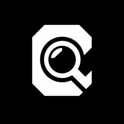

<div align="center">
  

  # Codiclens

  **A keyboard launcher for macOS. Hit ⌘Space, type a few letters, and open, find, paste or share anything on your Mac. Everything runs on your Mac, with no account.**
</div>

**Website:** [codiclens.codicstack.com](https://codiclens.codicstack.com) · [Releases](https://github.com/CodicStack/codiclens/releases) · [Changelog](CHANGELOG.md)

## Features

- Open apps, files and folders from one floating panel on ⌘Space
- Find files by name or by what they say
- Search by meaning: find a photo by what it shows or a recording by what it says, with models that run on your Mac
- Open a file right at the part that matched, with the words highlighted
- Clipboard history for text and images
- Emoji picker on ⌃⌘Space, with skin tones and recents
- Act on what you found: Paste, Share, Open With, Quick Look, read text out of images, make a QR code, rotate, rename
- Transcribe audio and video with [Codictate](https://codictate.app), if you have it
- No account, no analytics. Your files never leave your Mac

## Download

Grab the latest DMG from [**Releases**](https://github.com/CodicStack/codiclens/releases), open it and drag **Codiclens** to Applications.

On first launch, Setup asks which shortcuts to take over, which folders to index, how much of search by meaning to download, and whether to open at login. Every step is optional. Codiclens checks for updates once a day and tells you in the panel; it never pops up a window on its own.

### Requirements

- macOS 26.4 or later
- Apple Silicon (M1 or later)

## Build from source

**Requirements:** Xcode 26.4 or later, and [cmake](https://cmake.org) (`brew install cmake`).

```bash
git clone https://github.com/CodicStack/codiclens.git
cd codiclens
Scripts/build-llama.sh   # once, and again when the script's llama.cpp tag changes
xcodebuild -project codiclens.xcodeproj -scheme codiclens -configuration Debug build
```

Or open `codiclens.xcodeproj` in Xcode and press ⌘R. Debug builds sign to run locally, so you don't need an Apple developer account.

`Scripts/build-llama.sh` fetches llama.cpp at a pinned release and builds it into `Vendor/llama/` (not in git). It takes about 30 seconds. Without it the build stops with "llama.cpp is not built".

## Tests

```bash
xcodebuild test -project codiclens.xcodeproj -scheme codiclens
```

The unit tests never download a model, crawl your folders or take your shortcuts. A few heavier suites (the real model download, the real embedding helper, timing runs) are opt-in through `TEST_RUNNER_CODICLENS_*` variables; [AGENTS.md](AGENTS.md#tests) lists them.

## Project structure

```
codiclens/           # The app (Swift, SwiftUI, AppKit)
codiclensTests/      # Unit tests
CLlama/              # Module map for the llama.cpp build
Scripts/             # llama.cpp build, emoji index generator
docs/adr/            # Architecture decision records
AGENTS.md            # Architecture, rules and known issues
GLOSSARY.md          # The words we use for things in the app
```

## Contributing

See [CONTRIBUTING.md](CONTRIBUTING.md) and [CODE_OF_CONDUCT.md](CODE_OF_CONDUCT.md). Found a security issue? See [SECURITY.md](SECURITY.md).

## Releasing

Maintainers: see [docs/RELEASING.md](docs/RELEASING.md).

## License

Apache License 2.0. Copyright 2026 Emil Lykke Grann. See [LICENSE](LICENSE) and [NOTICE](NOTICE).

### Trademarks

Codiclens and Codictate are names of their author. The Apache License does not grant permission to use them or the Codiclens icon. Forks must use another name and icon.
